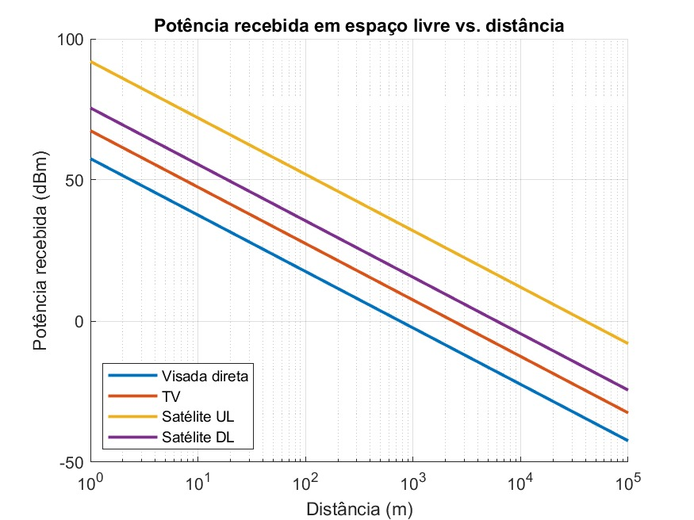

# 📶 Rádio Enlace Pau dos Ferros ⇄ Apodi (RN)

Projeto de engenharia da **1ª Unidade** da disciplina de Comunicações Sem Fio (UFERSA, Pau dos Ferros): dimensionamento de um enlace de dados **ponto a ponto de 100 Mbps** entre **Pau dos Ferros** e **Apodi**, com simulação no **Radio Mobile**, especificação de equipamentos e orçamento preliminar.

## 🎯 Resumo

A linha de visada direta entre as cidades é obstruída por maciços rochosos do Alto Oeste Potiguar. A solução adotada usa uma **estação repetidora ativa** em um cume intermediário, formando **dois trechos independentes**, ambos em **5725–5850 MHz** com rádios Ubiquiti airFiber 5XHD e antenas de 30 dBi em torres de 30 m. Os dois trechos têm margem superior a 25 dB sobre o limiar de −90 dBm adotado na simulação.

📄 [Relatório técnico](./docs/Relatorio.pdf) · 📊 [Orçamento (Excel)](./data/orcamento-radio-enlace.xlsx) · 📝 [Questões e resoluções](./docs/questoes.pdf) · 💻 [Script da Questão 3](./src/questao3.m)

## 📍 Topologia

| Estação | Latitude | Longitude | Altitude do terreno | Papel |
|---|---|---|---|---|
| A (UFERSA, Pau dos Ferros) | 06°08'33" S | 38°12'11" O | ~160 m | Transmissor (Master) |
| Repetidora (cume) | 06°00'58,0" S | 038°07'09,1" O | 677,1 m | Regenerador |
| B (Apodi) | 05°39'40" S | 37°47'55" O | ~130 m | Receptor (Slave) |

## 📐 Parâmetros dos enlaces

Altura das antenas: **30 m** em todos os sítios. Antenas: **30 dBi** (Tx e Rx). Potência de saída: **20 dBm**. Perda em cabos e conectores: **1 dB**. EIRP: **49 dBm** (≈ 79,43 W). Sensibilidade considerada: **−90 dBm**.

| Parâmetro | Trecho 1: A ↔ Repetidora | Trecho 2: Repetidora ↔ B |
|---|---|---|
| Distância | 16,83 km | 53,03 km |
| Azimute | 33,43° | 41,95° |
| Ângulo de elevação | +1,488° | −0,852° |
| Perda no caminho | 142,2 dB | 139,8 dB |
| Potência recebida | −64,2 dBm | −61,8 dBm |
| Margem sobre −90 dBm | 25,8 dB | 28,2 dB |
| Pior Fresnel | 8,6 F1 | 2,6 F1 |

> **Nota:** os valores acima seguem o [`Relatorio.pdf`](./docs/Relatorio.pdf). A perda em espaço livre a 5,8 GHz é ≈ 132 dB (16,8 km) e ≈ 142 dB (53 km), então vale conferir os valores de perda no caminho no Radio Mobile.

A capacidade de 100 Mbps é compatível com o equipamento, mas depende da largura de canal, do esquema de modulação, da relação sinal-ruído e da interferência no local.

## 🧰 Equipamentos (conforme a planilha de orçamento)

| Item | Modelo | Qtd. |
|---|---|---|
| Rádio | Ubiquiti airFiber 5XHD (AF-5XHD-BR) | 4 |
| Antena | Ubiquiti AF-5G30-S45 (30 dBi) | 4 |
| Cabo | UISP/TOUGHCable Carrier, Cat5e blindado outdoor | 1 caixa de 305 m |
| Conectores | TOUGHConnector TC-GND | 1 caixa com 20 |
| Proteção | Ubiquiti ETH-SP-G2 | 8 |
| Estrutura | Torre estaiada galvanizada de 30 m | 3 |
| Obra civil | Fundação preliminar 1,5 × 1,5 × 1,5 m | 3 |
| SPDA | Kit de aterramento com captor Franklin | 3 |
| Rede da repetidora | Switch Gigabit gerenciável | 1 |

São 4 rádios e 4 antenas porque a repetidora atende dois enlaces independentes e precisa de um conjunto por direção. O injetor PoE, a antena GPS, os suportes e os jumpers RF acompanham os rádios e as antenas.

## 💰 Orçamento preliminar (data-base 29/09/2026)

| Cenário | Materiais | Serviços, frete e contingência | **Total** |
|---|---|---|---|
| Mínimo | R$ 73.035,55 | R$ 28.146,76 | **R$ 101.182,31** |
| Base recomendada | R$ 98.782,55 | R$ 48.794,34 | **R$ 147.576,89** |
| Alto | R$ 149.889,05 | R$ 93.189,22 | **R$ 243.078,27** |

O orçamento **não inclui** o sistema de energia da repetidora, terrenos, licenças, impostos específicos nem mensalidades. A fundação é uma premissa acadêmica e exige sondagem, cálculo estrutural e ART. Detalhes e fontes de preço estão em [`data/orcamento-radio-enlace.xlsx`](./data/orcamento-radio-enlace.xlsx) (o GitHub não exibe planilhas, então é preciso baixar o arquivo).

## 📁 Estrutura da pasta

```
radio-enlace-pau-dos-ferros-apodi/
├── data/
│   └── orcamento-radio-enlace.xlsx   # Orçamento (materiais, serviços, fontes e premissas)
├── docs/
│   ├── Relatorio.pdf                 # Relatório técnico do projeto
│   └── questoes.pdf                  # Lista de questões e resoluções
├── img/
│   └── Questao3Grafico.jpeg          # Gráfico da Questão 3
├── src/
│   └── questao3.m                    # Script MATLAB da Questão 3
└── README.md
```

## 📊 Questão 3: potência recebida em espaço livre

O script [`src/questao3.m`](./src/questao3.m) calcula e plota a potência recebida de 1 m a 100 km para quatro sistemas, usando `Pr = Pt + Gt + Gr − Lfs`.

| Sistema | Frequência | Pt | Gt / Gr | Pr a 100 km |
|---|---|---|---|---|
| Visada direta | 10 GHz | 10 W | 35 / 35 dBi | −42,4 dBm |
| TV | 180 MHz | 1 kW | 10 / 15 dBi | −32,6 dBm |
| Satélite UL | 6 GHz | 1 kW | 60 / 20 dBi | −8,0 dBm |
| Satélite DL | 4 GHz | 10 W | 20 / 60 dBi | −24,5 dBm |



As curvas caem 20 dB por década e ficam paralelas no eixo logarítmico. Na distância de 1 m o modelo de Friis não vale (campo próximo), então os valores positivos não têm significado físico.

## ▶️ Como reproduzir

1. Abra [`src/questao3.m`](./src/questao3.m) no MATLAB (ou Octave) e execute. O gráfico é salvo em `img/Questao3Grafico.jpeg`.
2. Para o enlace, use o Radio Mobile com as coordenadas, alturas, frequências e potências das tabelas acima.
3. Para o orçamento, baixe e abra [`data/orcamento-radio-enlace.xlsx`](./data/orcamento-radio-enlace.xlsx). Os totais são calculados por fórmulas, e as premissas editáveis estão na aba *Fontes e Premissas*.

## 📖 Referências

- RAPPAPORT, T. S. *Comunicações sem fio: princípios e práticas*. 2ª ed. Pearson Prentice Hall, 2009.
- UBIQUITI INC. *airFiber AF-5XHD Datasheet*.
- UBIQUITI INC. *airFiber Antennas Datasheet*.

## 👥 Autores

- **João Lucas Oliveira de Andrade** ([@Iucasoa](https://github.com/Iucasoa))
- **João Pedro Fernandes de Aquino**

**Docente:** Francisco Carlos Segundo Gurgel · UFERSA, Pau dos Ferros, 2026
